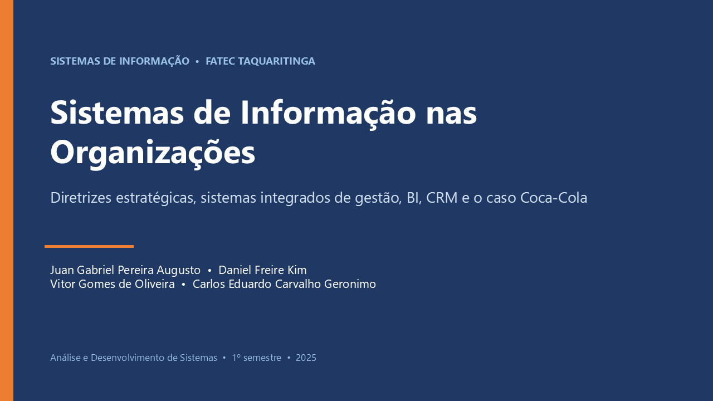

# 📊 Sistemas de Informação — PESI, COBIT, ERP, BI e CRM

Trabalho da disciplina de **Sistemas de Informação** na **Fatec Taquaritinga** sobre os sistemas de informação nas organizações: **diretrizes estratégicas** (PESI e COBIT), **sistemas integrados de gestão (ERP)**, **Business Intelligence**, **CRM** e um **estudo de caso da Coca-Cola**.



| Arquivo | Descrição |
|---|---|
| 📄 [`Trabalho_Sistemas_de_Informacao.pdf`](Trabalho_Sistemas_de_Informacao.pdf) | Trabalho completo (9 páginas) |
| 📝 [`Trabalho_Sistemas_de_Informacao.docx`](Trabalho_Sistemas_de_Informacao.docx) | Versão editável |
| 📊 [`Apresentacao_Sistemas_de_Informacao.pptx`](Apresentacao_Sistemas_de_Informacao.pptx) | Slides da apresentação (13 slides) |

---

## 🧭 Diretrizes estratégicas

| Ferramenta | Pergunta que responde | Ideia central |
|---|---|---|
| **PESI** – Planejamento Estratégico de SI | *O que fazer em TI?* | Alinhar os sistemas e a tecnologia à estratégia do negócio |
| **COBIT** – governança de TI (ISACA) | *Como garantir que a TI seja bem gerida?* | Processos, controles e indicadores em 5 domínios: EDM, APO, BAI, DSS e MEA |

**Etapas do PESI:** estratégia do negócio → diagnóstico atual → necessidades de informação → situação futura → priorização e plano de ação → acompanhamento.

---

## 🏭 Do MRP ao ERP

```
Anos 60          Anos 70           Anos 80              Anos 90
Controle de  →   MRP I         →   MRP II           →   ERP
estoque          (materiais)       (materiais +         (toda a empresa
                                    máquinas, pessoas,   em uma base
                                    finanças)            de dados única)
```

**Módulos do ERP:** financeiro e contábil · compras · vendas e faturamento · estoque e logística · produção · recursos humanos

| ✅ Benefícios | ❌ Limitações |
|---|---|
| Informação integrada e em tempo real | Custo alto |
| Menos retrabalho e erros | Implantação demorada |
| Processos padronizados | Adaptação dos processos ao sistema |
| Melhor controle de estoque e custos | Dependência do fornecedor e resistência dos usuários |

---

## 📈 Business Intelligence

Transforma dados em decisões: **ETL** (extração, transformação e carga) → **data warehouse** → análise com **OLAP**, mineração de dados e **dashboards** (Power BI, Tableau, Qlik).

## 🤝 CRM — Gestão de Relacionamento com o Cliente

| Tipo | Função |
|---|---|
| **Operacional** | Automatiza vendas, marketing e atendimento |
| **Analítico** | Analisa os dados dos clientes e gera relatórios |
| **Colaborativo** | Integra os setores com as mesmas informações do cliente |

**Implantação:** diagnóstico → escolha da plataforma (Salesforce, SAP CRM, HubSpot) → treinamento → testes e ajustes.

---

## 🥤 Estudo de caso: Coca-Cola

| | |
|---|---|
| **Desafio** | Processos manuais e dados de clientes espalhados entre sistemas e setores |
| **Solução** | CRM moderno, com dados centralizados, automação e chatbots |
| **Resultados** | Mais eficiência no B2B, mais fidelização no B2C e atendimento mais rápido |

---

## 📚 Referências

- ISACA. **COBIT 2019 Framework**. 2018.
- LAUDON, K. C.; LAUDON, J. P. **Sistemas de informação gerenciais**. 11. ed. Pearson, 2014.
- O'BRIEN, J. A.; MARAKAS, G. M. **Administração de sistemas de informação**. 15. ed. AMGH, 2013.
- REZENDE, D. A.; ABREU, A. F. **Tecnologia da informação aplicada a sistemas de informação empresariais**. 9. ed. Atlas, 2013.
- SOUZA, C. A.; SACCOL, A. Z. **Sistemas ERP no Brasil**. Atlas, 2003.
- STAIR, R. M.; REYNOLDS, G. W. **Princípios de sistemas de informação**. 11. ed. Cengage, 2015.
- TURBAN, E. et al. **Business Intelligence**. Bookman, 2009.

---

## 🎓 Informações acadêmicas

| | |
|---|---|
| **Instituição** | Fatec Taquaritinga |
| **Curso** | Análise e Desenvolvimento de Sistemas — 1º semestre |
| **Disciplina** | Sistemas de Informação |
| **Ano** | 2025 |

## 👥 Integrantes

- Juan Gabriel Pereira Augusto
- Daniel Freire Kim
- Vitor Gomes de Oliveira
- Carlos Eduardo Carvalho Geronimo
